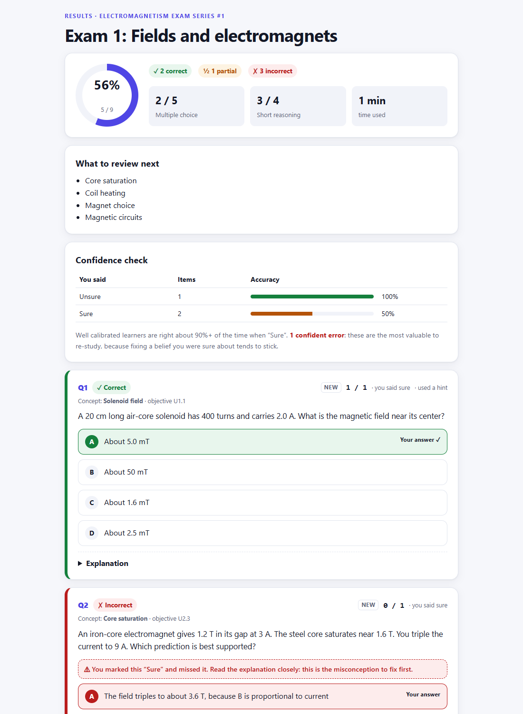
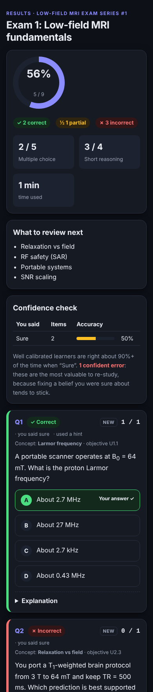
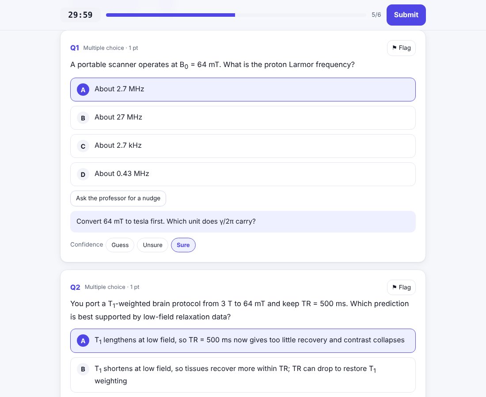
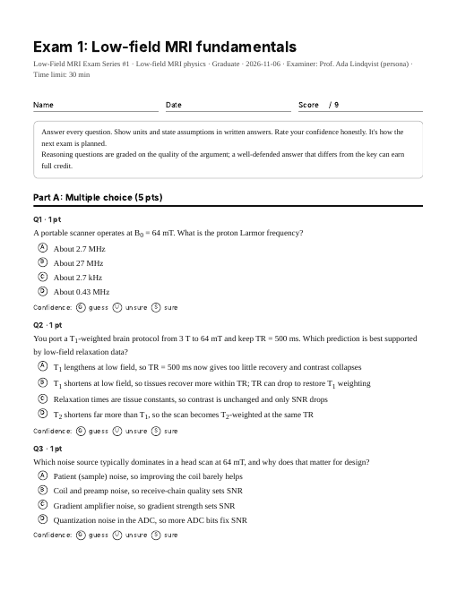

# Exam Coach

A Claude skill that writes hard practice exams from your syllabus, every few days, and uses your results to plan the next one.

[](../../actions/workflows/ci.yml)


<p align="center">
  
  
</p>

Give it a subject, a professor persona and your syllabus. Each exam:

- only tests what you've been taught, weighted toward core objectives
- uses scenario questions with tempting wrong answers, not recall
- cites a real, checked source for every answer
- marks each answer ✓ / ½ / ✗, explains every option, and asks how sure you were
- brings back what you're about to forget, and the mistakes you were confident about

Take it in the browser (timed, autosaved, auto-graded, works on a phone) or print it with a separate answer key.

## Install

**Claude apps:** download `exam-coach.skill` from the [latest release](../../releases) (or run `make package`) and upload it in **Settings → Capabilities → Skills**.

**Claude Code:**

```bash
/plugin marketplace add UalexU/exam-coach
/plugin install exam-coach@exam-coach
```

Or copy `skills/exam-coach/` into `~/.claude/skills/`.

Needs Python 3.9+ (standard library only). PDF export also needs Playwright + Chromium.

## Use

Just ask:

> Here's my syllabus for *Low-Field MRI Physics*. Every 3 days, give me a 40-minute exam (10 multiple choice, 2 short reasoning, 1 long reasoning) written by an MR hardware physicist who's strict about units. Make it hard.

> Plan exam #4 from my history.json, printable with an answer key.

> 8 untimed multiple-choice questions on Bayesian model checking.

Claude asks for anything missing, builds the exam and offers to schedule the next ones.

## How it works

1. Your syllabus becomes `syllabus.json`: units, dates and testable objectives.
2. `plan_next.py` reads your past results and picks what to test: spaced review, new material, and confident mistakes first. It keeps you at 65–85 % correct.
3. Claude finds sources, writes the questions, then re-checks them as a second examiner.
4. `build_exam.py` checks the exam against the rules and builds the page, paper and key.
5. Your results go into `history.json` for the next exam.

Run the scripts yourself:

```bash
python skills/exam-coach/scripts/plan_next.py examples/sample-history.json \
  --syllabus examples/sample-syllabus.json --today 2026-11-06 --questions 12

python skills/exam-coach/scripts/build_exam.py examples/sample-exam.json \
  --syllabus examples/sample-syllabus.json --out exam-out --pdf
```

## What you get

| Output | Contents |
|---|---|
| Interactive exam | Timer, confidence buttons (Guess / Unsure / Sure), optional hint from the professor, flags, autosave |
| Results | Score, ✓ / ½ / ✗ per question, explanations, sources, confident mistakes, what to review next |
| `paper.pdf` | Printable exam with answer space |
| `key.pdf` | Answers, rubrics, sources and a score sheet |

<p align="center">
  
  
</p>

Published as a Claude artifact, Claude can grade written answers and save your results. Without that, you grade written answers yourself against the rubric.

## Why it works

The design follows learning research: retrieval practice and spacing, interleaving, pretesting, and fixing confident errors first. Sources are in [`learning-science.md`](skills/exam-coach/references/learning-science.md).

In tests on four prompts, exams made with the skill passed 100 % of checks (72.5 % without it), and every question had a checked source. Details in [CHANGELOG.md](CHANGELOG.md).

## Development

```bash
make test       # unit tests
make test-ui    # browser test (needs requirements-dev.txt + Playwright)
make validate   # check the example exam
make package    # build dist/exam-coach.skill
```

See [CONTRIBUTING.md](CONTRIBUTING.md).

## License

[MIT](LICENSE) © 2026 Alex Villalba Gonzalez. Exams you generate are yours.
